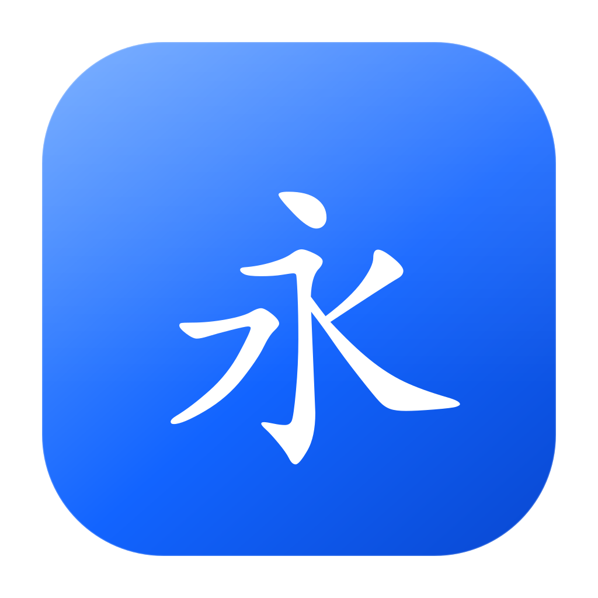

<p align="center">
  
</p>

<h1 align="center">CopyCraft Worksheet Studio</h1>

<p align="center">
  <a href="./README.md">简体中文</a> · <strong>English</strong>
</p>

<p align="center">
  
  
  
</p>

<p align="center">
  <a href="https://copycraft.looplooptech.com/">Website</a> ·
  <a href="https://github.com/niyongsheng/CopyCraft/releases">Download</a> ·
  <a href="https://pan.baidu.com/s/13Fdi5URwlZdvJKHMmYfZIg?pwd=58f7">Baidu Netdisk</a>
</p>

<p align="center">A worksheet generator for kids' handwriting practice, classroom teaching, and home practice. Supports <strong>Web / macOS / Windows</strong>, and all content is generated locally.</p>

<p align="center">
  
</p>

## Features

- **24 worksheet types**: names, Chinese characters, characters & words, pinyin dictation, classical poems, paragraphs, pinyin, stroke order, English letters, English words, pen control, numbers, arithmetic, vertical calculation, mixed operations, abacus mental math, blank practice paper, learning clock, and stroke order lookup.
- **Template library**: built-in textbook sync, structure rules, radicals, character & word, and workbook templates, with `?preset=` share links.
- **Workbook mode**: combine multiple worksheets (structure → characters → words → paragraphs) into one book and export every page at once.
- **Stroke order demo**: step through each stroke of a name, with options to stop after the last stroke and avoid repeated characters.
- **Dual-format export**: PDF for printing or downloading; Word with high-resolution A4 page images embedded.
- **Full customization**: font, size, line spacing, margins, eight grid styles, colors, and titles. Settings are remembered automatically.
- **Multilingual UI**: Simplified Chinese, Traditional Chinese, English, Japanese, and Korean, switchable instantly in Settings. Native desktop menus update as well.

## Development & Build

```bash
npm install
npm run dev          # Web: http://localhost:5178
npm run dev:desktop  # Electron + Vite HMR
npm run test:license # Activation / trial unit tests
npm run build:web    # Static site, output to dist/
npm run dist:mac     # macOS dmg / pkg / zip
npm run dist:win     # Windows NSIS / portable
npm run dist:win:zip # Windows portable zip
npm run pack:desktop # Unpacked .app / win-unpacked
```

## FAQ

**macOS says the app "is damaged and can't be opened"?**

The desktop build is ad-hoc signed and not notarized, so Gatekeeper quarantines downloads. The file itself is not damaged.

- Prefer the `.pkg`: its install script clears the quarantine flag automatically, so the app opens right after installation.
- If the `.pkg` itself is blocked, right-click → Open, or go to System Settings → Privacy & Security and click "Open Anyway".
- With the `.dmg`, drag the app into Applications, then run:

  ```bash
  xattr -dr com.apple.quarantine "/Applications/CopyCraft.app"
  ```

## Contact

- X: [@niyongsheng](https://x.com/niyongsheng)
- E-mail: niyongsheng@Outlook.com

## License

This project is open source under the [MIT](./LICENSE) license, Copyright © 2026 CopyCraft.

- [Privacy Policy](./PRIVACY.md)
- [Third-Party Notices](./THIRD_PARTY_NOTICES.md)
- [Arphic Public License (stroke data)](./ARPHICPL.TXT)
