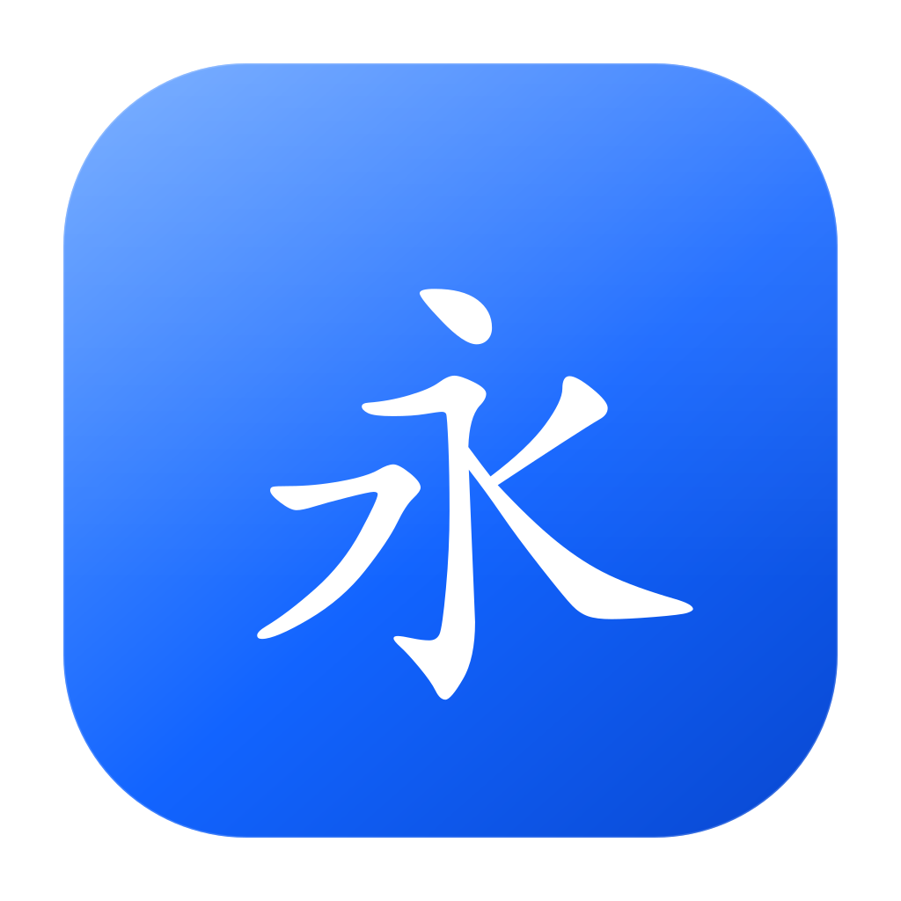

<p align="center">
  
</p>

# Copycraft 字帖工坊


面向练字、教学与家庭练习的字帖生成器，支持 **Web / macOS / Windows**，内容全部在本地生成。

## 功能

- **17 种字帖**：姓名、汉字、段落、拼音、笔画、英文、控笔、数字、数学运算、学习时钟与笔顺查询。
- **笔顺示范**：姓名逐笔推进，支持笔画完毕截断与不重复生成。
- **双格式导出**：PDF 矢量打印，Word 按高清 A4 页面图片嵌入。
- **完整定制**：字体、字号、行距、边距、八种格子、颜色与标题，设置自动记忆。

## 开发与构建

```bash
npm install
npm run dev          # Web: http://localhost:5178
npm run dev:desktop  # Electron + Vite HMR
npm run build:web    # 静态站点，输出 dist/
npm run dist:mac     # macOS dmg / zip
npm run dist:win     # Windows NSIS / portable
npm run dist:win:zip # Windows 免安装 zip
npm run pack:desktop # 未打包的 .app / win-unpacked
```